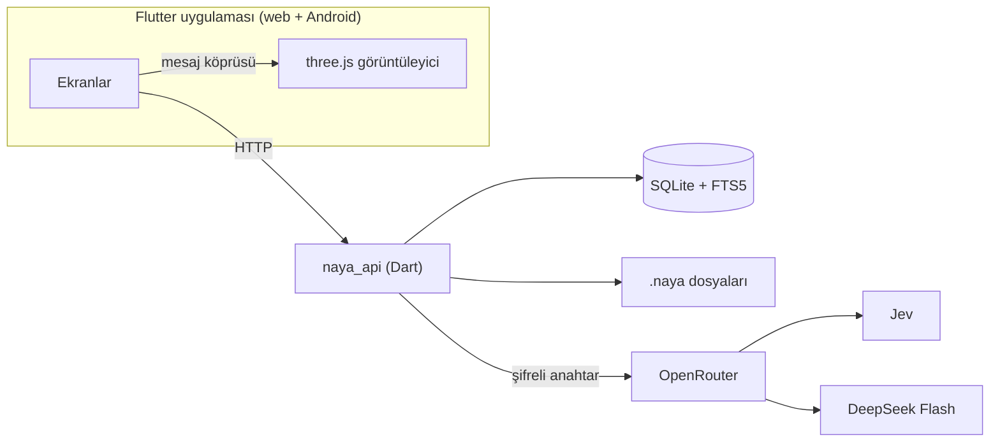

<h1 align="center">
  <picture>
    <source media="(prefers-color-scheme: dark)" srcset="assets/brand/naya-emblem-dark.svg">
    
  </picture>
  &nbsp;&nbsp;
  <picture>
    <source media="(prefers-color-scheme: dark)" srcset="assets/brand/naya-wordmark-dark.svg">
    
  </picture>
</h1>

S1000D teknik dokümanlarını 3D modellerle birleştiren, yapay zekâ destekli arıza teşhis ve bakım uygulaması. Flutter ile yazılıyor, web ve Android'de çalışıyor.

Malatya Turgut Özal Üniversitesi, Bilgisayar Mühendisliği Bölümü, Mobil Programlama dersi dönem projesi. Detaylı rapor için [Proje Ön Raporu.pdf](Proje%20Ön%20Raporu.pdf), genel plan için [PLAN.md](PLAN.md) dosyasına bakabilirsiniz.

## Proje hakkında

### Problem

Bir aracın, bisikletin ya da uçağın bakım bilgisi binlerce sayfalık teknik dokümanların içinde durur. Havacılık ve savunma sanayisinde bu dokümanlar S1000D standardıyla yazılır: bilgi küçük XML modüllere bölünür, makineler için düzenlidir ama insanlar için yorucudur. Bir arızanın kaynağını bulmak için doğru modülü bilmek, parça numaralarını çözmek ve çizimle metin arasında gidip gelmek gerekir.

Sıradan bir kullanıcı ise sorunu parça adıyla değil belirtiyle anlatır: "soğukken zor çalışıyor", "frende ses var". NAYA bu iki dünya arasında köprü kurar. Kullanıcının kendi cümlesiyle sorduğu soruya, sorunun kaynağı olan parçayı aracın 3D modeli üzerinde göstererek cevap verir.

### Amaç

1. **Görerek anlamak.** Her parça 3D modelde yerinde görünür; işlevi, arızaları ve tamir adımı tek dokunuşla açılır.
2. **Belirtiden parçaya.** Yapay zekâ belirtiyi okur, olası parçaları kalibre olasılıklarla sıralar ve en olasını gösterir.
3. **Taşınabilir bilgi.** Doküman, model ve eşleşmeler tek bir `.naya` dosyasında paylaşılır.

### Kapsam

| Başlık | Bu projede |
| --- | --- |
| Platform | Flutter ile tek kod tabanı: web ve Android |
| Hazır şablonlar | Bisiklet, araba (Corolla 1996 AE101), tank, savaş uçağı |
| İçe aktarma | Dışarıdan gelen S1000D dosyalarının `.zip` olarak yüklenip taranması |
| Yapay zekâ | Olasılık için Jev, anlatım için DeepSeek Flash; ikisi de OpenRouter üzerinden |
| Kapsam dışı | Gerçek askeri teknik veri. Şablonlar açık kaynak modeller ve genel bakım bilgisiyle hazırlanır |

### Nasıl çalışır

NAYA iki yönlü çalışır. Bir tarafta bizim hazırladığımız hazır şablonlar var: S1000D dokümanları, parçalara ayrılmış bir 3D model ve her parçanın görevini, bölgesini, arızalarını anlatan eşleşme dosyaları birlikte gelir. Diğer tarafta kullanıcının dışarıdan getirdiği S1000D dosyaları var: `.zip` olarak yüklenir, uygulama modülleri tanır, parça ağacını çıkarır; modeli olmayan içerik için sistem ağacından şematik bir görünüm üretilir. İkisi de aynı kütüphanede, aynı arayüzle açılır.

Model sayfasında üstte 3D model, altta sohbet durur. Kullanıcı modeli döndürebilir, parçalarına ayırabilir, tek bir parçayı yalıtabilir. Sorununu yazdığında model parçaları tarar, olası parçaları olasılığa göre parlatır ve kamera en olası parçaya gider. Parçaya dokununca işlevi, arızaları ve tamir prosedürü açılır.

Kimler için: sistemin parçalarını görerek öğrenmek isteyen öğrenci, arızanın olası kaynağına ve prosedüre hızlı ulaşmak isteyen teknisyen, ustaya gitmeden önce sorunun ne olabileceğini anlamak isteyen araç sahibi.

### S1000D ve `.naya` formatı

S1000D, teknik yayınları tekrar kullanılabilir küçük parçalara bölen uluslararası bir standart. Kullandığımız kavramlar: CSDB (modüllerin tutulduğu ortak kaynak), DM (tek konuyu anlatan XML modülü), DMC (her modülün benzersiz kodu), SNS (sistem numaralandırma), IPD (resimli parça listesi), ICN (çizim ve medya dosyaları). NAYA Issue 4.0 ve sonrasını okur.

NAYA bu modüllere dokunmaz; 3D modeli ve parça eşleşmelerini üzerine ayrı bir katman olarak ekler. `.naya` bir ZIP kabıdır:

```
arac.naya
├── mimetype          ilk kayıt
├── naya.json         manifest
├── csdb/             ham S1000D
├── model/
│   └── product.glb   ana model
├── map/              NAYA katmanı
│   ├── parts.json    parça ağacı, SNS, DM bağları, model düğümleri
│   ├── faults.json   belirtiler ve arızalar
│   ├── zones.json
│   └── hotspots.json
├── media/
└── ai/chunks.jsonl   isteğe bağlı
```

Dosya her zaman tekrar saf S1000D olarak dışa aktarılabilir. `parts.json` içindeki üst parça bağı hem parçalara ayırma animasyonunu hem teşhisi besler. Şablon başına hedef 50 MB'ın altı.

### Sistem mimarisi



- **İstemci:** Flutter, Feature-Sliced Design'a uyarlanmış katmanlarla (`app → pages → widgets → features → entities → shared`). Durum yönetimi Riverpod, yönlendirme go_router. 3D sahne iki platformda da aynı three.js kodu; web'de iframe, Android'de WebView içinde çalışır. Flutter tarafı görüntüleyiciyle küçük bir mesaj köprüsü üzerinden konuşur: `load`, `scan`, `highlight`, `explode`, `focus`, `isolate`, `xray`, `reset` ve geri yönde `partTap`.
- **Sunucu:** Dart ile yazılmış `naya_api`. API'yi ve web derlemesini aynı servis sunar. Hesaplar, kütüphane, `.naya` yükleme ve indirme, yapay zekâ çağrıları buradan geçer.
- **Veri:** tek bir SQLite dosyası (WAL modu, FTS5 ile tam metin arama, günlük yedek). Şema drift ile Dart kodunda tanımlı. Şifreler Argon2id, token'lar SHA-256, OpenRouter anahtarı AES-GCM ile saklanır; anahtar tarayıcıya geri dönmez.
- **Yayın:** Komuta üzerinde tek servis ve 10 GB disk, aylık yaklaşık 11 dolar. Docker yalnız yayın için; geliştirirken `dart run` ve `flutter run` yeterli.

`naya_format` ve `naya_s1000d` saf Dart olduğu için uygulama, sunucu ve komut satırı aracı aynı kodu kullanır.

### Teşhis ve yapay zekâ

Olasılığı sohbet modeline hesaplatmak her seferinde farklı sonuç verir. Bu yüzden iki model ayrı işler yapar: Jev belirtileri kalibre olasılıklara çevirir, DeepSeek Flash sonucu insan diliyle anlatır. Bir teşhis mesajı sırayla şu adımlardan geçer:

1. **Niyet:** teşhis mi, tamir mi, parça bilgisi mi, genel soru mu.
2. **Yeterlilik:** belirtiler bir parça seçmeye yetiyor mu; yetmiyorsa kullanıcıya soru sorulur.
3. **Sistem:** SNS sistemleri ve "hiçbiri" arasında olasılık dağılımı.
4. **Parça:** seçilen sistemin parçaları ve "hiçbiri" (Jev'in tek soruda en fazla 255 seçenek sınırı bu iki aşamalı seçimle aşılır).
5. **Arıza modu:** `faults.json`'daki o parçanın arızaları.
6. **Açıklama:** sonuç ve ilgili S1000D prosedür metni sohbet modeline verilir, DMC atıflarıyla anlatılır.

İki turun olasılıkları çarpılarak parçalar yan yana sıralanır:

```
P(parça) = P(sistem) × P(parça | sistem)
```

| Kural | Koşul | Sonuç |
| --- | --- | --- |
| Eşik | en yüksek birleşik P ≥ 0.35 | kamera parçaya gider |
| Fark | ilk iki parça arası < 0.10 | ikisi birlikte parlar, soru sorulur |
| Hiçbiri | sistem turunda en yüksek | parça seçilmez, soru sorulur |
| Arıza | en yüksek P(arıza) < 0.35 | muayene prosedürü önerilir |

Jev'e yalnız ürün bilgisi, parça açıklamaları, bilinen belirtiler ve kullanıcının son mesajları gider; 3D model ve medya gönderilmez. Her teşhisin tüm dağılımı kaydedilir, eşikler bu kayıtlarla sonradan ayarlanır. Bir teşhis yaklaşık 15 bin token, maliyeti 1 sentin altında.

### Çalışma şekli

Proje Kanban yaklaşımlı artımlı bir modelle, iki kişi sırayla çalışarak ilerliyor. Her adımın görevleri ikimize bölünür; biri kendi kısmını bitirip devrettiğinde sıra diğerine geçer. Her görev kendi dalında yapılır (`sahip/görev-id-kısa-ad`), her görev için ayrı PR açılır ve review olmadan hiçbir şey `main`'e girmez.

| Adım | Tarih | Mustafa Zahter | Enes Yeniçırak |
| --- | --- | --- | --- |
| 1. Kurulum ve format | 2–4 Kasım | Monorepo iskeleti, `.naya` v1, ilk tasarım | Flutter ve Android ortamı, CI, format testleri |
| 2. S1000D ve görüntüleyici | 5–7 Kasım | S1000D ayrıştırıcı, three.js görüntüleyici ve köprü | Uygulama iskeleti, ayrıştırıcı testleri |
| 3. Sunucu ve ilk şablon | 9–11 Kasım | Bisiklet şablonu, görüntüleyici efektleri | `naya_api`, model sayfası |
| 4. Yapay zekâ ve teşhis | 12–14 Kasım | Yapay zekâ hattı, teşhis ve tarama bağlantısı | Ayarlar, sohbet, geçmiş; Komuta yayını |
| 5. Şablonlar ve içe aktarma | 16–18 Kasım | Araba, tank ve uçak şablonları | ZIP içe aktarma ve dışa aktarma, uçtan uca test |
| 6. Cila ve teslim | 19–20 Kasım | Tasarım kalite turu | Performans ve erişilebilirlik |

Rapor ve sunumu birlikte hazırlıyoruz. Son teslim 13 Aralık 2026; 20 Kasım'dan sonrası tampon.

### Beklenen çıktılar

- Web ve Android'de çalışan NAYA uygulaması
- Dört hazır şablon ve `.naya` formatı v1
- Yayında bir sunucu ve web adresi
- Adım adım geliştirme dokümanları

İleride NAYA bir paylaşım platformuna dönüşebilir: herkes kendi `.naya` dosyasını hazırlayıp yükler, diğer kullanıcılar bunları keşfeder ve geliştirir.

> Detaylı rapor için buraya bakabilirsiniz: [Proje Ön Raporu.pdf](Proje%20Ön%20Raporu.pdf). Veritabanı tabloları, Jev isteğinin içi, olasılık örnekleri, ekranlar, riskler ve görev dağılımının tamamı orada.

## Dizinler

| Dizin | İçerik |
| --- | --- |
| `apps/naya` | Flutter uygulaması (web + Android) |
| `apps/naya_api` | Dart sunucusu |
| `packages/naya_format` | `.naya` okuma, yazma, doğrulama |
| `packages/naya_s1000d` | S1000D ayrıştırma |
| `packages/naya_diagnosis` | Teşhis akışı |
| `packages/viewer_web` | three.js görüntüleyici (TypeScript) |
| `templates/src` | Şablon kaynakları: modeller ve onları hazırlayan betikler |
| `tools/naya_cli` | `naya pack / unpack / validate / import` |
| `tools/fsd_lint` | FSD katman kuralını denetleyen analyzer eklentisi |
| `schemas` | JSON Schema dosyaları |
| `assets/brand` | Logo, açılış ve yükleme animasyonları |

Dart paketleri tek bir pub workspace içinde; bağımlılıklar kökte bir kez çözülür.

## Yerelde çalıştırma

Gerekenler: Flutter (stable), Node.js 20+, Chrome. Docker gerekmez.

```bash
flutter pub get                              # kökte, tüm paketler için
(cd packages/viewer_web && npm install)      # 3D viewer, bir kez
tools/dev.sh                                 # API + viewer + web uygulaması
```

Uygulama Chrome'da açılır. API `http://localhost:8080` (`/health` ile kontrol edilebilir), 3D viewer `http://localhost:5173` adresinde çalışır. Veriler `data/` klasöründe tutulur, git'e girmez.

Android'de ya da `tools/dev.sh` olmadan çalıştırırken uygulama içine gömülü viewer kullanılır; önce bir kez derlenip kopyalanmalı:

```bash
(cd packages/viewer_web && npm run bundle)
cd apps/naya && flutter run -d <telefon>
```

Ayrıntılar ve köprü komutları: [packages/viewer_web/README.md](packages/viewer_web/README.md).

## Kontroller

```bash
dart analyze             # tüm workspace, FSD kuralı dahil
(cd packages/viewer_web && npm run check)
dart format .
flutter test apps/naya
dart test apps/naya_api
```

Flutter uygulamasında katmanlar `app → pages → widgets → features → entities → shared` sırasındadır. Bir katman yalnız kendinden alttakileri import eder; aykırı bir import `dart analyze`'da hata verir.

## Kaynaklar

1. S1000D, International specification for technical publications. ASD/AIA/ATA.
2. Flutter belgeleri, flutter.dev
3. three.js belgeleri ve glTF 2.0 belirtimi, Khronos Group
4. TypeSafe AI, Jev API belgeleri
5. OpenRouter API ve model listesi belgeleri
6. SQLite FTS5, sqlite.org
7. drift, Dart için kalıcı veri kütüphanesi
8. Feature-Sliced Design, feature-sliced.design

## Ekip

- Muhammet Mustafa Zahter
- Enes Yeniçırak
